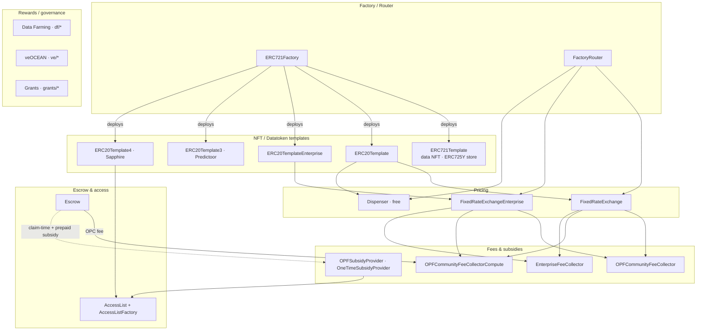

[](https://oceanprotocol.com)

<h1 align="center">@oceanprotocol/contracts</h1>

> 🦑 Core smart contracts for [Ocean Protocol](https://oceanprotocol.com).

Ocean Protocol turns data and compute services into on-chain assets. Each asset is a **data NFT** (ERC721) that represents the base IP; from it a publisher mints one or more **datatokens** (ERC20) that gate access to a service. This repository holds the Solidity (and Vyper) source for the full stack: NFT/datatoken templates, the factory and router that deploy and wire them, pricing (fixed-rate exchange, dispenser), the **escrow** layer that settles pay-per-use compute, **access-list** gating, community/enterprise **fee** collection, and the rewards, Data Farming and veOCEAN governance contracts.

- **Package:** `@oceanprotocol/contracts` (npm) / `ocean-contracts` (PyPI)
- **Version:** 3.1.0 (`main`)
- **Audits:** reviewed by [CertiK](#-audits--security) and [Halborn](#-audits--security) (reports in [`docs/`](docs/))
- **Deployment source of truth:** [`addresses/address.json`](addresses/address.json)

> Looking for client libraries? Use [ocean.js](https://github.com/oceanprotocol/ocean.js) (TypeScript) or [ocean.py](https://github.com/oceanprotocol/ocean.py) (Python). To run a service provider / compute node, see [Ocean Node](https://github.com/oceanprotocol/ocean-node), which integrates the Escrow, compute-fee and AccessList contracts in this repo.

## Table of contents

- [Architecture overview](#-architecture-overview)
- [Contract catalog](#-contract-catalog)
- [Deployed addresses & networks](#-deployed-addresses--networks)
- [Installation](#-installation)
- [Development & testing](#-development--testing)
- [Integration flows](#-integration-flows)
- [Roles & permissions](#-roles--permissions)
- [Audits & security](#-audits--security)
- [Contributing](#-contributing)
- [License](#-license)
- [Links](#-links)

## 🏛 Architecture overview

The contracts are organized into functional groups. A publisher deploys a data NFT through the factory, mints datatokens, attaches a pricing scheme, and consumers order datatokens to access the underlying service; fees route to community and (optionally) enterprise collectors, and pay-per-use compute is settled through escrow.



**Groups:**

- **NFT / datatoken templates** — `ERC721Template` (data NFT, with an ERC725Y key-value store); `ERC20Template` (standard datatoken), `ERC20TemplateEnterprise` (order-and-dispense in one call, no datatoken left in circulation), `ERC20Template3` (Predictoor prediction markets), `ERC20Template4` (Oasis Sapphire confidential variant).
- **Factory / Router** — `ERC721Factory` deploys NFTs and datatokens from registered templates via minimal-proxy clones; `FactoryRouter` whitelists base tokens / pricing contracts and routes fees.
- **Pricing** — `FixedRateExchange` and `FixedRateExchangeEnterprise` (fixed-price swaps), `Dispenser` (free allocation).
- **Escrow** — `Escrow` and `EnterpriseEscrow` hold and settle funds for pay-per-use services (compute), with deposit/authorize/lock/claim and `bundle()` (plain or ERC20Permit deposits plus authorizations in one tx). A lock can name **subsidy providers** that pre-fund part of it (lock-time *prepaid* sponsorship, accounted by the delegatecall-linked `SponsorshipLib`), so a fully-sponsored payer can run a job with zero deposit — complementing the older claim-time reimbursement. `EnterpriseEscrow` is the enterprise-line variant of `Escrow` and plays the same architectural role, so only `Escrow` is shown in the diagram above.
- **Access control** — `AccessList` (soulbound/optionally transferable ERC721 allow/deny lists) + `AccessListFactory`; plus the role systems inside `ERC721Template`/`ERC20Template` and the ERC725Y metadata store.
- **Fees** — `OPFCommunityFeeCollector` (protocol community fees) and a second deployment, `OPFCommunityFeeCollectorCompute`, that is the current tokenomics hook for compute fees (replacing the deprecated Balancer pool swap fee); `EnterpriseFeeCollector` for the enterprise line.
- **Subsidies** — `OPFSubsidyProvider` (rolling windows) and `OneTimeSubsidyProvider` (one-time rounds). Each can subsidize in two modes — **claim-time reimbursement** (released to the payer after a claim) and **prepaid lock-time sponsorship** (tokens pre-funded into the escrow lock, for zero-deposit jobs) — selectable per provider via `ISubsidyModeConfig` (`BOTH` / `REFUND_ONLY` / `PREPAID_ONLY`).
- **Rewards / Data Farming** — `df/*` (DFRewards, DFStrategyV1, Distribute, Splitter, vesting wallets), `rewards/BatchPayments`, `rewards/Booster`.
- **veOCEAN governance** — `ve/*` (veOCEAN vote-escrow, delegation, fee distribution, allocation — Vyper + Solidity).
- **Grants** — `grants/*` (GrantsToken, GrantsSwap, GrantsTokenFaucet).
- **Predictoor** — `utils/PredictoorHelper` alongside `ERC20Template3`.

> ⚠️ **Deprecated:** the Balancer AMM pool model (`pools/balancer/*`, `poolTemplate`, side `Staking`) is kept in-tree for legacy mainnet/EVM deployments but is **not** deployed on newer chains (optimism, base, oasis_sapphire, …). Do not build new integrations on it; use the fixed-rate exchange, dispenser and escrow instead.

## 📇 Contract catalog

Paths are relative to this repo (links resolve on `main`). "Deployed?" reflects [`addresses/address.json`](addresses/address.json) — see [networks](#-deployed-addresses--networks) for exact coverage.

| Contract | Path | Purpose | Deployed? |
|---|---|---|---|
| ERC721Template | [`contracts/templates/ERC721Template.sol`](contracts/templates/ERC721Template.sol) | Data NFT; base IP + ERC725Y key-value store + roles | Core — all chains |
| ERC20Template | [`contracts/templates/ERC20Template.sol`](contracts/templates/ERC20Template.sol) | Standard datatoken (access token) | Core — all chains |
| ERC20TemplateEnterprise | [`contracts/templates/ERC20TemplateEnterprise.sol`](contracts/templates/ERC20TemplateEnterprise.sol) | Enterprise datatoken: buy + order + dispense atomically | Via factory templates |
| ERC20Template3 | [`contracts/templates/ERC20Template3.sol`](contracts/templates/ERC20Template3.sol) | Predictoor prediction-market datatoken | Via factory templates |
| ERC20Template4 | [`contracts/templates/ERC20Template4.sol`](contracts/templates/ERC20Template4.sol) | Confidential datatoken for Oasis Sapphire | Sapphire |
| ERC721Factory | [`contracts/ERC721Factory.sol`](contracts/ERC721Factory.sol) | Deploys NFTs/datatokens from registered templates | Core — all chains |
| FactoryRouter | [`contracts/pools/FactoryRouter.sol`](contracts/pools/FactoryRouter.sol) | Base-token/pricing whitelist + fee routing (`Router`) | Core — all chains |
| FixedRateExchange | [`contracts/pools/fixedRate/FixedRateExchange.sol`](contracts/pools/fixedRate/FixedRateExchange.sol) | Fixed-price datatoken ↔ base-token swaps (`FixedPrice`) | Core — all chains |
| FixedRateExchangeEnterprise | [`contracts/pools/fixedRate/FixedRateExchangeEnterprise.sol`](contracts/pools/fixedRate/FixedRateExchangeEnterprise.sol) | Fixed-rate exchange for the enterprise line (`FixedPriceEnterprise`) | Newer chains |
| Dispenser | [`contracts/pools/dispenser/Dispenser.sol`](contracts/pools/dispenser/Dispenser.sol) | Free datatoken allocation | Core — all chains |
| Escrow | [`contracts/escrow/Escrow.sol`](contracts/escrow/Escrow.sol) | Pay-per-use settlement (deposit/authorize/lock/claim) + prepaid lock sponsorship | Newer chains |
| EnterpriseEscrow | [`contracts/escrow/EnterpriseEscrow.sol`](contracts/escrow/EnterpriseEscrow.sol) | Escrow for the enterprise line | Newer chains |
| SponsorshipLib | [`contracts/escrow/SponsorshipLib.sol`](contracts/escrow/SponsorshipLib.sol) | Delegatecall library: escrow prepaid (lock-time) subsidy accounting | Newer chains (linked by `Escrow`) |
| AccessList | [`contracts/accesslists/AccessList.sol`](contracts/accesslists/AccessList.sol) | Soulbound/optional ERC721 allow/deny list | Via AccessListFactory |
| AccessListFactory | [`contracts/accesslists/AccessListFactory.sol`](contracts/accesslists/AccessListFactory.sol) | Clones AccessList instances | Newer chains |
| OPFCommunityFeeCollector | [`contracts/communityFee/OPFCommunityFeeCollector.sol`](contracts/communityFee/OPFCommunityFeeCollector.sol) | Collects protocol community fees | Core — all chains |
| OPFCommunityFeeCollectorCompute | (deployment of `OPFCommunityFeeCollector.sol`) | Compute-fee collector — current tokenomics hook | Newer chains |
| EnterpriseFeeCollector | [`contracts/communityFee/EnterpriseFeeCollector.sol`](contracts/communityFee/EnterpriseFeeCollector.sol) | Fee collection for the enterprise line | Newer chains |
| OPFSubsidyProvider | [`contracts/subsidy/OPFSubsidyProvider.sol`](contracts/subsidy/OPFSubsidyProvider.sol) | Rolling-window subsidy — claim-time refund + prepaid lock sponsorship | Selective |
| OneTimeSubsidyProvider | [`contracts/subsidy/OneTimeSubsidyProvider.sol`](contracts/subsidy/OneTimeSubsidyProvider.sol) | One-time (per-round) subsidy — claim-time refund + prepaid lock sponsorship | base (`SubsidyProviders`) |
| DFRewards / DFStrategyV1 | [`contracts/df/`](contracts/df/) | Data Farming reward distribution | mainnet + selective |
| BatchPayments | [`contracts/rewards/BatchPayments.sol`](contracts/rewards/BatchPayments.sol) | Batched reward/payment disbursal | sapphire, base |
| Booster | [`contracts/rewards/Booster.sol`](contracts/rewards/Booster.sol) | Soulbound ERC721 incentive-boost factor | mainnet (`OceanNodesBooster`) |
| veOCEAN stack | [`contracts/ve/`](contracts/ve/) | Vote-escrow governance (Vyper + Solidity) | mainnet (+ legacy testnets) |
| Grants (COMPY) | [`contracts/grants/`](contracts/grants/) | Grants token, faucet, swap | base, sepolia |
| PredictoorHelper | [`contracts/utils/PredictoorHelper.sol`](contracts/utils/PredictoorHelper.sol) | Batch helper for Predictoor | sapphire |
| ERC725 store | [`contracts/utils/ERC725/ERC725Ocean.sol`](contracts/utils/ERC725/ERC725Ocean.sol) | ERC725Y key-value metadata (used by the data NFT) | Embedded in NFT |
| Balancer AMM pool | [`contracts/pools/balancer/`](contracts/pools/balancer/) | ⚠️ Deprecated AMM pool + side staking | Legacy EVM chains only |
| OceanToken | [`contracts/utils/OceanToken.sol`](contracts/utils/OceanToken.sol) | Test/legacy OCEAN ERC20 (mainnet OCEAN is external) | Testnets / legacy |

Template details: [`contracts/templates/README.md`](contracts/templates/README.md).

## 🌐 Deployed addresses & networks

All deployed addresses, `startBlock` values and `chainId`s live in [`addresses/address.json`](addresses/address.json) — treat it as the single source of truth; the compiled ABIs live separately in `artifacts/` (generated by `npx hardhat compile`; shipped in the npm package but not committed to the repo). The deployed set varies per chain: **core** contracts (`ERC721Factory`, `ERC721Template`, `ERC20Template`, `Router`, `FixedPrice`, `Dispenser`, `OPFCommunityFeeCollector`) exist on every network; newer contracts (`Escrow`, `EnterpriseEscrow`, `SponsorshipLib`, `AccessListFactory`, `EnterpriseFeeCollector`, `FixedPriceEnterprise`, `OPFCommunityFeeCollectorCompute`) are on the actively maintained chains; and the legacy AMM pool/`Staking`, Data Farming/veOCEAN, grants, subsidies and `PredictoorHelper` appear only where relevant.

The 19 networks currently in `address.json`:

| Network | chainId | | Network | chainId |
|---|---|---|---|---|
| mainnet | 1 | | filecointestnet | 3141 |
| polygon | 137 | | gaiaxtestnet | 2021000 |
| bsc | 56 | | gen-x-testnet | 100 |
| moonriver | 1285 | | oasis_sapphire_testnet | 23295 |
| energyweb | 246 | | optimism_sepolia | 11155420 |
| optimism | 10 | | pontus-x-devnet | 32456 |
| base | 8453 | | polygonedge | 81001 |
| oasis_sapphire | 23294 | | mumbai | 80001 |
| sepolia | 11155111 | | goerli | 5 |
| alfajores | 44787 | | | |

> `mumbai` and `goerli` are deprecated testnets kept for historical reference.

## 📚 Installation

Install the package to consume ABIs and deployed addresses — you normally do not compile this repo to integrate.

**JavaScript / TypeScript**

```bash
npm install @oceanprotocol/contracts
```

```js
// ABIs
const ERC721Factory = require("@oceanprotocol/contracts/artifacts/contracts/ERC721Factory.sol/ERC721Factory.json");
// Deployed addresses, keyed by network
const addresses = require("@oceanprotocol/contracts/addresses/address.json");
const factoryOnOptimism = addresses.optimism.ERC721Factory;
```

**Python**

```bash
pip3 install ocean-contracts
```

The published PyPI package exposes two importable packages: `addresses` (holds `address.json`)
and `artifacts` (the compiled ABIs, flattened at publish time to `artifacts/<ContractName>.json`
— not the nested `artifacts/contracts/<Name>.sol/<Name>.json` path of the npm layout shown above).
The `__init__.py` files that make these importable are generated when the wheel is built, so they
exist in the installed package but not in a git clone of this repo. Load the deployment addresses
as plain JSON (the legacy `json-sempai` approach is no longer needed):

```python
import json, os
import addresses  # the `addresses` package from ocean-contracts

address_path = os.path.join(os.path.dirname(addresses.__file__), "address.json")
with open(address_path) as f:
    deployments = json.load(f)
factory_on_optimism = deployments["optimism"]["ERC721Factory"]
```

## 🦑 Development & testing

### Prerequisites

- **Node.js `v20.19.0`** (see [`.nvmrc`](.nvmrc); `nvm use`)
- **Solidity** — the project compiles **both `0.8.12` and `0.8.26`** (`AccessList` and `Booster` are `^0.8.26`; `Escrow`/`EnterpriseEscrow` compile with `0.8.12` + the IR pipeline). See [`hardhat.config.js`](hardhat.config.js).
- **Vyper** — `0.3.1`, `0.2.15`, `0.2.7`, `0.2.4` for the veOCEAN contracts (installed automatically by `@nomiclabs/hardhat-vyper`).
- OpenZeppelin `^4.8.3`, ethers `^5.7.2`, hardhat `^2.22.8`.

Install dependencies:

```bash
nvm use
npm install
```

### Environment variables

| Variable | Used for |
|---|---|
| `NETWORK_RPC_URL` | RPC endpoint for a target network (deploy/verify, barge) |
| `PRIVATE_KEY` | Deployer key for live networks |
| `ETHERSCAN_API_KEY` | Contract verification |
| `GANACHE_MNEMONIC` | Accounts for barge-stack testing (defaults provided) |
| `COINMARKETCAP_API_KEY` | Optional, gas reporter pricing |

### Compile & run a local node

```bash
npx hardhat compile
npx hardhat node
```

### Tests

The full suite:

```bash
npm run test:full          # unit + flow tests
npm run test:full:cover    # with coverage (solidity-coverage)
```

Broad groups:

```bash
npm run test:unit          # datatoken unit tests (ERC20TemplateEnterprise)
npm run test:flow          # end-to-end flow tests (test/flow/*)
```

Granular targets:

| Script | Covers |
|---|---|
| `test:escrow` | `Escrow` unit tests |
| `test:enterpriseEscrow` | `EnterpriseEscrow` unit tests |
| `test:fre` | FixedRateExchange flow |
| `test:fre:enterprise` | FixedRateExchangeEnterprise flow |
| `test:enterpriseFeeCollector` | EnterpriseFeeCollector unit tests |
| `test:dispenser` | Dispenser flow |
| `test:template3` | ERC20Template3 (Predictoor) |
| `test:template4` | ERC20Template4 (Sapphire) |
| `test:erc721` / `test:erc20` / `test:enterprise` | Template unit tests |
| `test:factory` | ERC721Factory |
| `test:router` | FactoryRouter |
| `test:batch` | Batch swap flow |

### Barge (local Ocean stack)

To test against the local [barge](https://github.com/oceanprotocol/barge) stack, use the dedicated [`hardhat.config.barge.js`](hardhat.config.barge.js), which targets the barge ganache network (`chainId 8996`) and reads `NETWORK_RPC_URL`:

```bash
npx hardhat --config hardhat.config.barge.js test
```

> Barge copies `hardhat.config.barge.js` over `hardhat.config.js` at build time; the two must keep the same compiler `overrides`.

## 🔁 Integration flows

The canonical, maintained walkthroughs live at [docs.oceanprotocol.com](https://docs.oceanprotocol.com); most integrators use [ocean.js](https://github.com/oceanprotocol/ocean.js) or [ocean.py](https://github.com/oceanprotocol/ocean.py) rather than calling contracts directly. At the contract level:

1. **Publish** — call `ERC721Factory.createNftWithErc20()` (bundle helper) to deploy a data NFT and its first datatoken in one tx, then call `setMetaData()` on the NFT to emit the `MetadataCreated` event that Aquarius/indexers consume. Writing the ERC725Y key-value store alone does **not** emit `MetadataCreated`.
2. **Set pricing** — attach a `FixedRateExchange` / `FixedRateExchangeEnterprise` for paid access, or a `Dispenser` for free access.
3. **Gate access (optional)** — deploy an `AccessList` via `AccessListFactory`. On `ERC20Template4` (Oasis Sapphire) datatokens only, attach it with `setAllowListContract()` (the list must be **soulbound** — deploy it with `transferable=false` — **and** be deployed by the same `AccessListFactory` that was passed as the factory address when the datatoken was created; otherwise `checkAccessList` fails its `isDeployed`/`isSoulBound` checks and the call reverts with `IAL`) to gate which **providers** may retrieve the files object via `getFilesObject()` (it does not restrict on-chain ordering). On other chains AccessList is not wired into the datatokens; it is consumed by the subsidy providers (`OPFSubsidyProvider` / `OneTimeSubsidyProvider`) as user/node membership gates.
4. **Consume / order** — a consumer buys a datatoken and calls `startOrder()` (or the enterprise `buyFromFreAndOrder()` / `buyFromDispenserAndOrder()` one-shot), which pays provider + community fees. Fees route to `OPFCommunityFeeCollector` / `OPFCommunityFeeCollectorCompute` and, for the enterprise line, `EnterpriseFeeCollector`.
5. **Pay-per-use compute** — funds are held and settled through `Escrow` / `EnterpriseEscrow`: the payer deposits and authorizes payees with a max locked amount, max lock duration, max lock count and an auth-expiry timestamp (`authorize(token, payee, maxLockedAmount, maxLockSeconds, maxLockCounts, expiryTimestamp)`, where `expiryTimestamp` `0` = never); the payee then locks (`createLock(..., jobType, subsidyProviders)`) and later claims. Subsidy providers named on a lock can pre-fund it (prepaid sponsorship), so a fully-sponsored payer can run a job with zero deposit (authorize with `maxLockedAmount = 0` for a sponsored-only lock). See [`contracts/escrow/Escrow.sol`](contracts/escrow/Escrow.sol) for the deposit/authorize/lock/claim, prepaid-sponsorship and `bundle()` flow.

   > These are the **v2** escrows (`version()` returns `2`) — a **breaking ABI change** vs v1: `authorize`/`createLock`/`reLock` (and their batch/`bundle` variants) gained parameters and the `Auth` event signature changed, so clients built on the old ABI must regenerate. Capabilities are discoverable via ERC-165 — `supportsInterface` advertises `IEscrowCore` and `IEscrowLockSubsidy` (plus `IEscrowEnterprise` on `EnterpriseEscrow`), and `escrowKind()` distinguishes community (`0`) from enterprise (`1`). Note that `getUserFunds(payer, token).locked` now tracks only the payer-funded portion of a lock; the sponsored portion is read via `getSponsoredTotal(token)` / `getSponsorship(payee, payer, jobId)`.

> The in-repo `docs/quickstart_*.md` guides describe the older Ocean v4 publisher/roles flows and are kept for historical reference; prefer [docs.oceanprotocol.com](https://docs.oceanprotocol.com) for current guidance.

## 🔑 Roles & permissions

- **Data NFT (`ERC721Template` + `ERC721RolesAddress`):** the NFT owner is the top authority and can assign per-NFT roles — **manager**, **deployER20** (mint new datatokens), **updateMetadata**, and **store updater** (ERC725Y). Managers can grant/revoke the other roles.
- **Datatoken (`ERC20Template` + `ERC20Roles`):** **minter** (mint datatokens), **payment manager** (collect/route payments), and **fee manager** roles, assigned by the NFT/datatoken deployer.
- **Access lists:** `AccessList` tokens are minted only by the list owner. On `ERC20Template4` (Sapphire) datatokens only, allow/deny membership gates which **providers** may retrieve the files object (via `getFilesObject()`), not on-chain ordering; on other chains AccessList membership is used by the subsidy providers as user/node gates.
- **Protocol:** fee collectors, subsidy providers and the router are `Ownable`; escrow authorizations are controlled by the payer per payee.

## 🔒 Audits & security

Security reports are in [`docs/`](docs/):

- [CertiK Verification Report for Ocean Protocol](docs/CertiK%20Verification%20Report%20for%20Ocean%20Protocol.pdf)
- [Halborn Smart Contract Security Audit Report](docs/Ocean_Protocol_Smart_Contract_Security_Audit_Report_Halborn_Final%20%281%29.pdf)

> These audits predate some of the newer subsystems (Escrow, AccessList, the enterprise line, subsidies). Treat any contract not covered by a listed report as **unaudited** and review before relying on it in production.

To report a vulnerability, please **do not** open a public issue — email security@oceanprotocol.com or follow the disclosure process at [docs.oceanprotocol.com](https://docs.oceanprotocol.com). For non-security bugs, [open a GitHub issue](https://github.com/oceanprotocol/contracts/issues/new/choose).

## 🤝 Contributing

Issues and pull requests are welcome. Please run `npm run test:full` before submitting, match the existing Solidity version and OpenZeppelin usage, and flag any change to deployed/upgradeable contracts for storage-layout and audit review.

## 🏛 License

```
Copyright (C) 2026 Ocean Protocol Foundation

Licensed under the Apache License, Version 2.0 (the "License");
you may not use this file except in compliance with the License.
You may obtain a copy of the License at

   http://www.apache.org/licenses/LICENSE-2.0

Unless required by applicable law or agreed to in writing, software
distributed under the License is distributed on an "AS IS" BASIS,
WITHOUT WARRANTIES OR CONDITIONS OF ANY KIND, either express or implied.
See the License for the specific language governing permissions and
limitations under the License.
```

## 🔗 Links

- Documentation: https://docs.oceanprotocol.com
- Website: https://oceanprotocol.com
- ocean.js (TypeScript): https://github.com/oceanprotocol/ocean.js
- ocean.py (Python): https://github.com/oceanprotocol/ocean.py
- Ocean Node: https://github.com/oceanprotocol/ocean-node
